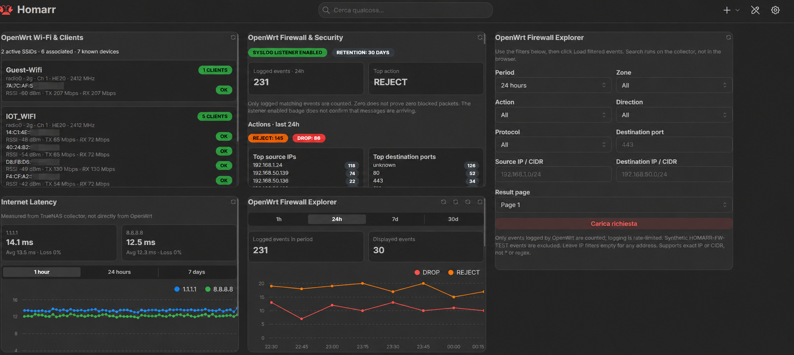

# OpenWrt Network & Security Monitor for Homarr

**Release candidate: v0.2.8-alpha** · [English guide](docs/en/README.md) · [Guida italiana](docs/it/README.md)

A self-hosted, read-oriented OpenWrt monitoring collector for **Homarr 2.x**, deployed in Docker / TrueNAS SCALE. Collect router/WAN health, Wi-Fi associations, latency history, firewall syslog, client history, health alerts, and classification of observed external/private traffic. SQLite keeps history across container upgrades.

> **Release status:** pre-1.0. Collector and widgets have been iteratively tested on a real OpenWrt + Homarr deployment; the final v0.2.8 charts and end-to-end upgrade must still be validated on the target Homarr instance. This is **not** a complete network-flow analyzer or an IDS.

## Features

| Feature | Collector API | Homarr widget |
| --- | --- | --- |
| Router / WAN status | `/router` | `widgets/router.json` |
| Wi-Fi networks and clients | `/wifi` | `widgets/wifi.json` |
| Latency history | `/latency`, `/latency/chart?hours=1` | `widgets/latency.json` |
| Firewall overview | `/firewall` | `widgets/firewall.json` |
| Wi-Fi device history | `/wifi/history` | `widgets/wifi-history.json` |
| Firewall Explorer, CIDR filters | `/firewall/explorer/24`, `/firewall/events` | `widgets/firewall-explorer.json` |
| Network health and alerts | `/network/health` | `widgets/network-health-widget.json` |
| External traffic analysis | `/external/traffic?hours=24` | `widgets/external-traffic-widget.json` |

The **external** monitor counts firewall log records classified by source IP address. The upstream ISP router can drop Internet traffic **before** OpenWrt sees it. Zero public-source events therefore **does not prove there were zero Internet scans**. Logged events are rate-limited and are not packet totals or flow records.

## Quick start

1. Read [English installation](docs/en/README.md) or [installazione italiana](docs/it/README.md).
2. Configure a **dedicated least-privilege OpenWrt RPC account**; see [ACL example](openwrt/homarr-monitor-acl.json) and adjust to installed rpcd packages.
3. Copy `collector/.env.example` to `.env`, set a strong `COLLECTOR_KEY` and RPC credentials, and set `DEMO_MODE=false`. Do **not** commit `.env`.
4. Build the collector image from `collector/`, mount a writable persistent `/state` volume, and optionally enable OpenWrt remote syslog on UDP 5514.
5. Import each desired file in `widgets/` to Homarr. Replace example `192.0.2.10` with your collector's reachable host/IP and set the Bearer token **inside Homarr**, never in a shared JSON file.
6. Confirm `/health`, then authenticated endpoints; see [API and troubleshooting](docs/en/README.md#troubleshooting).

## Security and privacy

- No passwords or tokens belong in git, screenshots, issue logs, or exported Homarr widgets.
- `.gitignore` excludes `.env`, databases, logs, backups, and state; a [pre-commit hygiene check](tests/check_repo.py) scans release files for common leaks.
- The collector uses HTTP with a Bearer token. Keep it on a trusted LAN/VPN; do not expose port 8788 or UDP 5514 to the public Internet.
- Syslog can contain client IPs, MACs and connection metadata. Do **not** upload the persistent SQLite database to GitHub.
- The daemon runs as a non-root user inside the container. The example does not require privileged networking or root RPC access.
- This project does **not** require enabling router DMZ, NAT forwarding, or UPnP.

## Repository layout

```text
collector/        Python collector, Dockerfile, env template
widgets/          Importable Homarr Custom Widget JSON definitions
truenas/          Docker Compose reference
openwrt/          Read-only rpcd ACL example, syslog notes
docs/en/          Full documentation in English
docs/it/          Documentazione completa in italiano
tests/            Static validation and hygiene checks
.github/          GitHub Actions validation
```

## Screenshots

### Dashboard


## Release & contribution status

This is an **independent project** and is not affiliated with OpenWrt, Homarr, TrueNAS, or TIM. A separate public GitHub repository and Homarr Workshop entry have **not** been created or confirmed yet. See [CHANGELOG](CHANGELOG.md), [SECURITY](SECURITY.md), [CONTRIBUTING](CONTRIBUTING.md), and [release checklist](docs/en/RELEASE.md).

**License:** MIT (see [LICENSE](LICENSE)).

## Manual integration test runbooks

- [English: TrueNAS + OpenWrt tests](docs/en/TESTING.md)
- [Italiano: test TrueNAS + OpenWrt](docs/it/TESTING.md)
